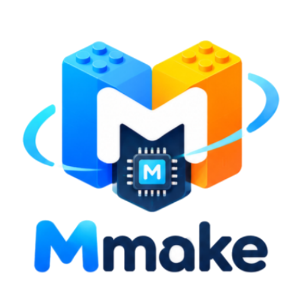

# 掌控图形化编程（Mmake）



面向中小学**信息科技 / 人工智能**课堂的图形化编程平台：拖积木 → 生成 MicroPython →
一键上传到**掌控板（mPython）**，同时配套**虚拟仿真**与**舞台演示**两种运行视图。

> 纯前端、单页、免安装；数据保存在浏览器本地，不上传服务器。

**在线体验：<https://xinlin.kicp.fun/>**　|　**源码：<https://github.com/Ixinlin/mmake-block-studio>**

---

## 它能做什么

| 模块 | 说明 |
|---|---|
| 积木编程 | 基于 Blockly，中文积木，按「控制 / 逻辑 / 屏幕显示 / 运动 / 外观 / 变量 / 掌控板 / 高级」分类 |
| 代码生成 | 实时生成可读的 MicroPython 代码，格式与 mPython 官方示例一致 |
| 上传真机 | WebSerial 直连，raw REPL 写入 `main.py`，无需安装 mPython IDE |
| 虚拟仿真 | 2D 掌控板 + 拓展设备卡片，可拖滑杆造数据、点按键、摇晃、模拟传感器 |
| 舞台演示 | 情景化舞台（书房 / 交通 / 校园…），元素可拖动，掌控小助手同步屏幕、可用 A/B 键与 PYTHON 触控 |
| 拓展库 | 40+ 传感器 / 执行器，悬停看详细介绍，点「▶ 视频介绍」看分镜动画 |
| **画笔** | 拓展库「其他」里的画笔扩展（Scratch pen）：落笔 / 抬笔 / 变色 / 粗细 / 图章 / 全部擦除 + 「当点击运行时」，点 ▶ 直接在舞台上画图，不需要任何硬件 |
| **蓝牙** | BLE HID 键盘 / 鼠标（第 8 课）：开启蓝牙键盘、判断已连接、发送按键、模拟鼠标点击 |
| **物联网** | SIoT / MQTT 全套积木（初始化 / 连接 / 订阅 / 发布 / 收到消息），仿真支持「虚拟通道」（多标签页互发，断网可用）与「真实服务器」（WebSocket）两种模式 |
| **舞台背景** | 外观模块新增「将舞台背景设为颜色 / 纯白·纯黑·浅灰·天蓝·草地绿」，刷白后画几何图形最清楚；背景随工程一起保存，恢复默认一键还原 |
| **控制模块分组** | 控制模块按「事件程序 / 按键与触摸 / 等待 / 循环 / 循环控制 / 停止 / 输出与计时」7 组分类，每组积木上方显示类别文字；「跳出循环」与「继续下一轮循环」各有一块预置积木 |
| **MQTT 消息弹窗** | 拓展库 MQTT 新增「弹窗输出 MQTT 消息」积木（默认放「MQTT 收到的消息内容」），运行后在右下角弹出消息卡片，显示主题 / 内容 / 时间；相同消息 1.5 秒内合并计数，可清空、可关闭。真机侧转换为串口打印 |
| **手机端** | 竖屏 / 横屏各自紧凑布局，无「请切换为横屏」弹窗、不锁定屏幕方向；进入时按屏幕宽度自动适应缩放，也可点右下角「－ / 百分比 / ＋ / 适应」或双指捏合自由缩放；舞台模式 + 虚拟仿真可一键收起，收起后常驻「展开面板」按钮与右侧把手随时展开，竖屏展开时改为「上编程区 + 下全宽舞台」的上下布局 |
| **水质监测** | 拓展库新增 **TDS 水质传感器**（HS-S79-PL / SEN0244，0~1000ppm，AO 默认 P0）与 **溶解氧传感器**（SEN0237，0~20mg/L，AO 默认 P1）；均为模拟量，接好引脚后用「读取模拟引脚」或专用值积木读数，仿真卡片与舞台元素可直接拖滑杆造数据 |
| **停止全部脚本** | 控制模块新增 Scratch 式「停止全部脚本」：运行后立刻停掉所有并发程序（含其它事件启动的程序），右上角按钮与状态栏同步恢复 |
| **无线广播** | 在拓展库添加「无线广播」后，积木区出现该分类：开关、频道（1~13）、发送消息、收到广播时、收到指定内容时、收到的内容、读取一条消息共 7 块；参考官方 radio 教程，能直接打开官方广播示例 `.mxml` |
| **掌控板分类** | 掌控板是一个分类平铺全部积木，各组上方显示类别文字（彩灯 / 板载传感器 / 声音与音乐 / 语音识别与朗读 / 引脚与 ADC）；与控制模块重复的事件积木已隐藏，按键判断积木迁到控制模块。左侧顺序为 控制→逻辑→屏幕显示→运动→外观→变量→掌控板→高级 |
| **雨滴传感器** | 拓展库新增（LM393，AO 接 P0）：用「读取模拟引脚 P0 ≥ 200」或「雨滴传感器 模拟值」积木判断下雨，卡片与舞台上都能拖「雨量」 |
| **舞台直接调参** | 舞台模式下的温湿度、雨滴、超声波、光线元素下方有参数卡，直接拖滑杆改温度 / 湿度 / 雨量 / 距离，虚拟仿真卡片同步 |
| **C 形积木** | 如果 / 一直重复 / 重复 N 次拖到别的积木上会自动把下方积木包进执行槽，高度随内容自适应，吸附半径加大 |
| 素材库 | 内置音乐、图片、表情、情景元素（含**画笔**），支持上传自定义素材 |
| 工程文件 | 保存为 `.mxml`，可直接用 mPython IDE 打开；**舞台情景（背景 / 角色 / 位置 / 背景色）随工程一起保存**，打开即还原；也支持打开官方 mxml / py |

## 运行方式

### 1. 在线版（推荐给课堂）

浏览器打开 <https://mmake4.kicp.fun/>，
**必须用 Edge 或 Chrome**（上传真机依赖 WebSerial）。

### 2. Windows 桌面版

下载 `Mmake.exe` 双击运行：程序会把网页释放到
`%LOCALAPPDATA%\Mmake\web`，再用 Edge / Chrome 打开，然后自身退出。
没有常驻后台进程；工程数据跟着浏览器走，路径固定所以不会丢。

> 没有 Edge / Chrome 的机器，可在命令行执行 `Mmake.exe --serve`，
> 程序会起一个本地 HTTP 服务并给出访问地址。

### 3. 源码运行

```bash
git clone https://github.com/Ixinlin/mmake-block-studio.git
cd mmake-block-studio
# 直接用浏览器打开 index.html 也能跑（file:// 属于安全上下文，WebSerial 可用）
# 更稳妥的是起个静态服务：
npx serve .
```

## 打包 Windows 桌面版

产物是**单个 32 位 exe**，覆盖 **Windows 7 SP1 / 8 / 10 / 11**（32 位与 64 位系统都能跑）。

> **为什么必须是 Python 3.8 32 位**：Python 3.9+ 的 `python3x.dll` 依赖
> `api-ms-win-core-path-l1-1-0.dll`，这个 API Set 是 **Windows 10 才引入** 的，
> Win7 上 DLL 加载直接失败，**装补丁也救不回来**；PyInstaller 6.0+ 也随之放弃 Win7/8。
> 所以兼容 Win7 的配方只能是 **Python 3.8（官方支持 Win7 的最后一版）+ PyInstaller 5.13.2**，
> 并且打 **32 位**——32 位 exe 在 32/64 位 Windows 上都能跑，Win7 教室机有不少还是 32 位。

```bash
node tools/setup-py38.js          # 一次性准备工具链（约 3 分钟，只需跑一次）
node tools/make-icon.js           # 由 docs/logo/Mmake-source.png 生成圆角 logo 与 ICO
node tools/build-publish.js       # 生成 publish/（干净网页，已抹掉内置凭据）
node tools/build-exe.js           # 打包 dist/Mmake.exe，并自动做兼容性自检
```

`setup-py38.js` 下载的是 **Python 3.8.10 嵌入式包**，解压到 `build/py38/` 即用：
不需要管理员权限、不写注册表、不碰系统 PATH，删掉目录就恢复干净。
之后 `build-exe.js` 会自动挑这台 3.8 来打包；如果只剩 Python 3.9+，
它会**明确警告产物跑不了 Win7**，不会默默打个不能用的包。

`build-exe.js` 会：

1. 生成一份干净的 `publish/`；
2. **随机生成 256 位资源密钥**，分片混淆后写入 `tools/exe/_buildkey.py`（不入库）；
3. 把 `publish/` 加密打包成 `build/web.pak`；
4. 用 PyInstaller 把「启动器 + 加密资源包」打成单文件 exe，并嵌入图标与版本信息。

运行时启动器解密 `web.pak` → 释放到 `%LOCALAPPDATA%\Mmake\web` → 用 Edge/Chrome 打开。
资源包带 SHA-256 校验，且用指纹文件 `web.pakid` 判断是否已释放过，二次启动秒开。

> **关于"加密"的能力边界**：网页是纯前端，代码必然要送到用户机器上。
> 这里做的是**资源包加密** —— 用 7-Zip 打开 exe 只能看到 `web.pak` 的乱码，
> 拿不到 html/js/css 明文。它挡得住"顺手把源码拷走"，**挡不住专业逆向**。
> 真正的保护请靠开源协议与版权声明。

## 开发

```bash
npm install                       # 只装开发依赖（jsdom / playwright）
node tools/run-tests.js           # 跑全部测试
node tools/run-tests.js r50       # 只跑某一轮
```

### 构建/打包脚本

| 脚本 | 作用 |
|---|---|
| `tools/build-publish.js` | 生成 `publish/`：可托管的干净网页（抹掉内置 API 凭据、替换教材示例） |
| `tools/build-repo.js` | 生成开源仓库目录（把运行时、构建脚本、测试、README/LICENSE 归拢到一起） |
| `tools/make-icon.js` | 由原始 logo 生成圆角透明 PNG 与多尺寸 ICO（用 Playwright + canvas，无需 Pillow） |
| `tools/pack-web.js` | 把 `publish/` 加密打包成 `build/web.pak` |
| `tools/build-exe.js` | 一键打包 `dist/Mmake.exe`（含密钥注入、图标、版本资源） |
| `tools/exe/launcher.py` | exe 启动器：解密资源包 → 释放 → 调 Edge/Chrome 打开 |
| `tools/exe/pakcrypto.py` | 资源包解密（纯标准库：`hashlib.shake_256` 密钥流 + SHA-256 校验） |
| `tools/setup-py38.js` | 一键准备 Python 3.8 32 位 + PyInstaller 5.13.2（打 Win7 可用 exe 的工具链） |
| `tools/pe-info.py` | 零依赖读 PE 头，看 exe 是 32/64 位、最低能跑在哪个 Windows |
| `tools/png-info.py` | 零依赖读取 PNG，查看尺寸/通道/alpha，用于核对 logo |

### 目录结构

```
index.html              入口
css/style.css           全部样式
js/
  app.js                主流程、工具栏、拓展库、运行控制
  blocks-defs.js        积木定义（含自定义积木）
  toolbox.js            工具箱分类与影子块
  gen-python.js         积木 → MicroPython
  gen-sim.js            积木 → 仿真执行代码
  sim-engine.js         仿真运行时（解释执行生成的 JS）
  sim-board.js          2D 掌控板与拓展设备卡片
  stage.js / stage-scene.js   舞台与情景元素、画笔层、背景覆层、舞台参数卡
  mqtt-bus.js           MQTT 双通道（跨标签页虚拟总线 + WebSocket 真实客户端）
  board3d.js            掌控板 3D 视图
  serial-link.js        WebSerial + raw REPL 上传
  project.js            工程存取 / mxml 导入导出
  py2blocks.js          Python → 积木（教材示例反解）
  device-intro.js       拓展设备介绍与「视频介绍」
  ...                   素材库、音乐、二维码、语音、视觉等
vendor/blockly/         Blockly 10 运行时
docs/logo/              logo 素材（原始方图 + 圆角透明版）
tools/                  构建与测试脚本
test-r*.js              各轮功能的回归测试
```

### 技术要点

- **Blockly 10**：两条反序列化路径（`fromXml` / `loadState`）行为不同，拖拽走后者。
- **上传协议**：官方 raw REPL 时序 `\r\n\x03\x03` → `\r\n\x01` → 横幅 →
  命令 + `\x04` → `OK` + stdout`\x04`stderr`\x04`>`。
  写入采用「**先按 UTF-8 字节切分，再逐块转义**」，避免转义序列被切断造成 `SyntaxError`。
- **仿真**：把积木编译成一段 JS，由 `sim-engine` 用异步解释器跑，
  与真机共用同一份状态模型，所以「仿真能跑的，真机基本也能跑」。

## AI 功能（可选）

语音识别 / 合成、人脸、文字、物体识别走**讯飞开放平台**。
本仓库**不内置任何 API 凭据**（避免泄露账号额度），
需要时在界面右上角 **⚙ AI 设置** 里填自己的 `APPID / APIKey / APISecret`，
保存在浏览器 localStorage，不会写进文件。

不填也能正常使用其余全部功能，只是识别类积木会返回 401。

## 已知限制

- 上传真机仅支持 Chromium 内核浏览器（Edge / Chrome / 国产 Chromium 浏览器）。
- **Windows 7 上**：系统自带的旧版 Edge 不带 WebSerial，需要
  Chrome 109 或更早版本（110 起不再支持 Win7），或 360 极速浏览器 X /
  QQ 浏览器 / 搜狗高速浏览器这类仍支持 Win7 的国产 Chromium 内核浏览器。
  只做仿真和舞台演示的话不装也能用，只是不能上传真机。
- **Windows 7 上还需**安装 KB2999226（通用 C 运行库 UCRT），
  否则 `python38.dll` 加载失败。一般装过 Chrome 的机器都已经有了。
- 蓝牙（BLE HID）只能模拟按键/鼠标事件，真机上还取决于电脑/手机的配对；
  虚拟仿真里用设备卡片的「模拟连接 / 断开」切换。
- MQTT 仿真默认走虚拟通道（同一浏览器的多个标签页互通）；
  要连真实 broker，在 MQTT 卡片里填 WebSocket 地址（如
  `ws://broker.emqx.io:8083/mqtt`），公开服务器延迟与可用性不受本项目控制。
- 教材（湘科版）示例数据未随开源版分发。

## 参与贡献

欢迎提 Issue / PR。提交前请：

1. `node tools/run-tests.js` 全绿；
2. 新增功能补一份 `test-rNN.js`；
3. 不要把任何密钥、内网地址、学生个人信息写进代码或测试。

## 许可证

[MIT](LICENSE)
